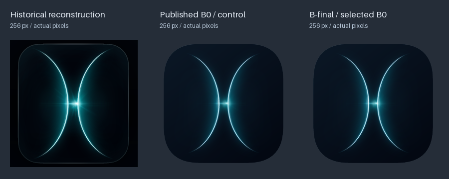

# Anamorph product icon: design review

**Final recommendation: published Candidate B (B0) unchanged, pending owner brand approval.** This is a separate
product design, not another attempt to minimize error against `reference.png`.
No artwork has been integrated into Anamorph.



The focused [final visual review](PRODUCT_ICON_FINAL_REVIEW.md) records the
independent observations made before experiments, exact B1/B2/F1/F2/S1/S2
settings, native-size findings and rejected refinements. B0 remains stronger
overall; no cosmetic change was invented to mark completion. Start with the
[final candidate sheet](../assets/anamorph/previews/final/candidates.png),
[four-background review](../assets/anamorph/previews/final/backgrounds.png),
[native-size ladder](../assets/anamorph/previews/selected-size-ladder.png) and
[mask/source study](../assets/anamorph/previews/final/masking.png).

The following A/B/C sheets document the earlier design stage and remain
available as its archive. They are not a reopened direction-selection study.

## Review images

- [All candidates at 1024 px](../assets/anamorph/previews/comparison-1024.png)
  and [512 px](../assets/anamorph/previews/comparison-512.png). Each column uses
  the same canvas scale; the final column repeats the recommended B explicitly.
  Light desktop sheets are also available at
  [1024 px](../assets/anamorph/previews/comparison-1024-light.png) and
  [512 px](../assets/anamorph/previews/comparison-512-light.png).
- Native [128 light](../assets/anamorph/previews/comparison-128-light.png) /
  [dark](../assets/anamorph/previews/comparison-128-dark.png),
  [64 light](../assets/anamorph/previews/comparison-64-light.png) /
  [dark](../assets/anamorph/previews/comparison-64-dark.png),
  [32 light](../assets/anamorph/previews/comparison-32-light.png) /
  [dark](../assets/anamorph/previews/comparison-32-dark.png),
  [16 light](../assets/anamorph/previews/comparison-16-light.png) /
  [dark](../assets/anamorph/previews/comparison-16-dark.png).
- [Selected size ladder](../assets/anamorph/previews/selected-size-ladder.png)
  includes 16, 24, 32, 48, 64, 128, 256, 512 and 1024 px. Open at 100% to
  inspect native pixels; the browser's fit-to-window view is not a size test.
- [Small optical treatment](../assets/anamorph/previews/small-optical-comparison.png)
  and [independent enclosure versus approximate Apple shape](../assets/anamorph/previews/masking-comparison.png).
  The latter is a geometry study, **not a native Liquid Glass render**.
- [Corner curvature comparison](../assets/anamorph/previews/corner-study.png)
  keeps square bounds and nominal corner extent constant.
- Retained [candidate SVGs and full-resolution PNGs](../assets/anamorph/previews/candidates/).

## Why the old icon appeared rectangular

The historical SVG and render are 1024 × 1024, but its frame centerline spans
`x = 66.5225..951.57`, `y = 34.3555..991.6551`: **885.0475 × 957.2996**,
height/width **1.08164**. Including its 6.135-unit stroke, the envelope is
891.1825 × 963.4346. Left/right centerline margins are 66.5225/72.43; top/bottom
are 34.3555/32.3449. The dark exterior is opaque across the whole canvas, so
alpha bounds alone would incorrectly report a square visible body.

Its two-cubic curves span approximately y 86..949 and x 217..779. Their tall
optical structure reinforces the frame's vertical reading. The measured frame
uses three circular arcs per corner (main radius 163.5607, blend radius
639.0638, blend angle 5.0916°), not a generic circular rounded rectangle.
Historical decisions D68–D78 explain the tip continuation, taper, width,
colour-field and curve/light separation; those records and measurements remain
untouched.

The original frame center is `(509.04625, 513.0053)`; the curves' measured
mirror axis is x 505.03. The flare anchor `(529.95, 514.33)` and its displaced
compact peak are intentionally asymmetric. Thirty-two historical optical
layers distinguish the halo, lens, streaks and directional rays; they are not
interchangeable copies of a symmetric starburst.

## Square transformation and preserved identity

The new enclosure is constructed directly at `(32,32)..(992,992)`:
**960 × 960**, with equal margins. It has its own superellipse-inspired
corners, subtle blue-black field and a restrained edge of 1.6 units in B.
It replaces the tall frame in the *new composition only*.

The measured motif receives a uniform 0.9 scale and translation from anchor
`(505.03,515)` to `(512,512)`. No nonuniform SVG transform is used. All four
original cubics, their normal offsets, directional rays and radial light
shapes retain their relationships. Nominal tip heights become about
126..902: balanced space inside the new square. The original right-biased
interaction stays near `(534.43,511.40)`; centering the light itself would
misrepresent the relationship between the curves.

The independent enclosure uses radius 310.3 and exponent 2.61. These are a
measured approximation of the current Apple template's contour, scaled to the
960-unit body, rather than a claimed universal platform radius. See
[Apple research and native workflow](APPLE_ICON_WORKFLOW.md) for the measurement
and the distinction between this shape and Apple's actual system mask.

## Candidates and decisions

| Direction | Changes and strengths | Weaknesses / native small-size inspection | Decision |
|---|---|---|---|
| Square baseline | New enclosure and uniform positioning; historical optical colours and gains | Retains the busiest rays and brightest central interaction | Control for layout, retained |
| A — conservative | 5% less glow, 8% less flare, minimal colour change; closest continuity | Fine diffraction and glow merge more at 16–32 px; less background separation | Credible conservative alternative, retained |
| B — premium optical | Glow ×0.79, flare ×0.74, fine-ray gain ×0.32; cooler cyan/blue hierarchy; clearer dark field | Master cores become delicate at tiny sizes | **Recommended**, with explicit 16–32 px optical treatment |
| C — restrained glass | Broader filled bands from the same cubic ribbons; less glow, brighter blue field | Parallel edges at the tips draw attention to material construction; smallest sizes lose clarity | Rejected as default; retained for review and native material exploration |

B preserves the opposing luminous curves, asymmetry, white interaction and
optical atmosphere. Its premium character comes from proportion and light
hierarchy. There are no new symbols, text, rainbow effects, chrome borders,
noise or extrusion. C is an authored static study, not a claim to reproduce
Apple's dynamic material.

## Colour and optical hierarchy

Historical core colour is `[216.24,255,255]`; B's derived core is approximately
`[199.29,230.11,255]`, surrounded by reduced cyan glow. Its field runs from
`#0b1826` to `#030812`. This is a local adjustment to curve layers; the flare's
white remains neutral. The historical red-shift fields are kept for the
baseline/A and intentionally omitted from B/C's cleaner lighting hierarchy.

[Measured validation](PRODUCT_ICON_VALIDATION.json) compares clipping, light
mass above/below and left/right, and sRGB/D65 Oklab midtones. These are
diagnostics, not a fidelity objective or a substitute for the comparison sheets.
No product design is scored against the reference PNG's MAE.

B's measured optical midtone hue is 226.79° in Oklch versus 211.02° in the
historical render. Light above a 20/255 luminance floor is 49.855% on the left
and 52.027% above the horizontal center; its centroid is `(508.29,501.02)`.
This supports a balanced horizontal mass and a modest optical lift. No pixel
has all three channels at or above 250 in the 1024 px product master.

At 16–32 px, the optical variant widens core paths ×1.65, reduces noncore glow
×0.64 and flare ×0.55, and omits fine rays/vertical diffraction. It keeps the
same measured curves and placement. At 40 px and above the regular master is
used. The ICO, PNG matrix and icon-theme files obey that policy by *pixel size*,
including Retina slots whose actual raster size is 32 px.

## Architecture and reproducibility

`src/build_svg.py`, `src/params.json`, `reconstruction.svg`, `reference.png`,
historical tests and decision records remain the historical product. Their
reproduction command is unchanged.

`design/anamorph.json` is the independent editable design state.
`src/product_icon.py` derives an in-memory light stack from the pinned
historical parameters and reuses `Builder.layer`, the Bézier geometry,
variable-width ribbons, gradients and superellipse utility. It does not clone
the renderer or write historical state. A historical-parameter digest guard
requires an explicit review if that dependency ever changes.

The canonical selected output is
[`assets/anamorph/master/anamorph.svg`](../assets/anamorph/master/anamorph.svg).
Earlier A/C alternatives remain editable archive sources. A future change to
the recommendation requires a new visual review and an explicit update to
the final acceptance record and B0 preservation check; changing `selected`
alone would contradict this round's unchanged-artwork decision. Keep the
frozen B0 control available for comparison.

```sh
sh tools/publish_product_icon.sh
# Or run the independent stages:
python tools/export_product_icon.py
python tools/test_product_icon.py --cross-renderer
python tools/export_product_icon.py --check
```

All rasters are direct vector renders at the intended size. The deterministic
package records exact source-content revisions, dependency versions, asset
digests, dimensions, transparency, colour interpretation, targets and validation
status in its [asset matrix](../assets/anamorph/manifests/ASSET_MATRIX.md) and
[machine-readable manifest](../assets/anamorph/manifests/assets.json).
